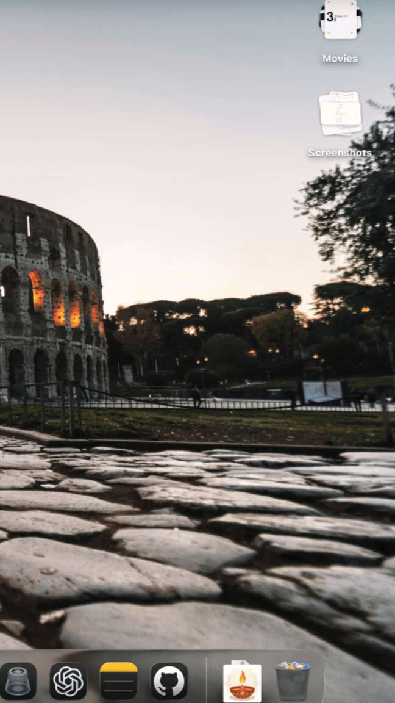

# Pixel Break Buddy

A macOS break reminder that walks onto your desktop when it's time to step away.

Pixel Break Buddy explores how a small character, motion, and personality can make
a routine reminder feel more approachable. It is a UI/UX and AI-assisted development
portfolio project built with Electron, HTML, CSS, and JavaScript.



[Watch the full desktop demo — original MP4, 27 seconds](docs/demo/pixel-break-buddy-demo.mp4)

Real screen recording of the working macOS application. The silent GIF uses cropped
excerpts and briefly holds the Angry state for readability; the full video preserves
the original recording and audio track.

**Status:** tested local beta candidate · Apple Silicon · macOS 13+ · not notarized.
No public download or GitHub release has been published yet.

## The product problem

During focused work, it's easy to postpone breaks or dismiss a generic notification.
Pixel Break Buddy makes the reminder visible through a familiar desktop companion,
then gives the user clear choices: take a break or snooze. It is a timing aid, not a
medical product or a guarantee of improved health or productivity.

## Experience and features

- Work sessions of 30, 45, or 60 minutes; default 60.
- Breaks of 5, 10, or 15 minutes; default 5. Snooze defaults to 10 minutes.
- Transparent, always-on-top mascot window with a six-frame walking entrance.
- Happy → Annoyed → Angry expressions, small anticipation/blink/settle transitions,
  and locally synthesized retro sounds with mute, volume, and previews.
- Pixel-style speech bubbles with clear Take a Break and Remind Me Later actions.
- Mascot customization controls for design, color, size, accessories, and personality.
- Persistent settings, a native macOS menu-bar icon, pause/resume, immediate breaks,
  session restart, and packaged-app Launch at Login.
- Immediate test reminder preview that leaves the real session deadline intact.
- Reduced-motion support, crisp pixel rendering, click-through empty window areas,
  and reminders shown without requesting keyboard focus.

### Emotional progression

| State | Normal timing after reminder starts | Design intent |
|---|---|---|
| Happy | Immediately; bubble and sound follow the entrance | A friendly invitation to pause |
| Annoyed | 2 minutes | A more noticeable reminder without adding a modal interruption |
| Angry | 3 minutes total | A brief expressive shake and firmer message; break/snooze remain available |

The existing character PNGs have different poses. Expression changes use a short
blink/squash and an instantaneous image swap rather than overlapping crossfades.
Walking frames advance with distance, with a gentle stop before the speech bubble
appears. These decisions preserve character alignment and keep the interface readable.

The menu-bar controls remain available while the mascot is hidden. Settings changes
apply to future timer phases instead of unexpectedly restarting an active countdown.

## Preview and case study media

The recorded GIF and full desktop video are linked above. Separate screenshots have
not been added. See [docs/README.md](docs/README.md) for media details and the capture
plan. All demo visuals come from the running application.

## AI-assisted development

The project began with Cursor AI and continued with OpenAI Codex for incremental
implementation, debugging, tests, Electron migration, packaging, and repository review.
The project creator directed the product goals and visual identity and reports seven
successful manual post-upgrade acceptance tests. AI assistance is part of the process,
not a substitute for testing or a claim that the app was independently security certified.

The three mascot emotion PNGs were generated using ChatGPT. The walking sprite sheet
was generated using ChatGPT based on the creator's original mascot design; a local
script aligns its frames. The app does not call an AI API to operate. See
[ASSET-LICENSE.md](ASSET-LICENSE.md) for provenance and separate distribution terms.

## Run locally

Requirements: macOS 13+, Node.js 22.12+ (a supported LTS version is recommended), npm,
and Git. The existing build target is Apple Silicon. Python 3 and macOS iconutil are
only needed when regenerating artwork derivatives or the app icon.

From a local checkout:

```sh
cd pixel-break-buddy
npm ci
npm start
```

Electron may download its development binary on first launch. Do not run a second
copy alongside an installed instance when testing: the app deliberately enforces a
single instance. Launch at Login is available in the packaged macOS app, not development.

### Automated and accelerated testing

```sh
npm test
npm run test-mode
```

Test mode uses 20-second work sessions, 5/10-second emotion thresholds, 15-second breaks,
and 10-second snoozes. It does not overwrite the saved production durations. Quit and
launch normally to leave test mode.

In a normal packaged run, choose **Show Test Reminder Now** from the Buddy menu-bar
icon. Choose **End Test Reminder** to return to the real timer; the real countdown
continues during the preview. The preview respects mute and volume settings.

## Build and install the local macOS app

```sh
npm run build:mac
node scripts/verify-package.cjs
```

The output is `dist/mac-arm64/Pixel Break Buddy.app`. Quit the running copy, copy the
whole app to Applications, and open it in Finder. It includes its runtime and does
not need Node.js, Terminal, Cursor, or Codex to stay open. Place it in its permanent
location before enabling Launch at Login.

The current app is ad-hoc signed and unnotarized. Gatekeeper can block downloaded
copies; follow [Apple's guidance](https://support.apple.com/en-us/102445) for this
specific app rather than disabling system protections. There are no automatic updates.
To generate the local beta DMG without publishing, run `npm run build:dmg`.
See [PACKAGING.md](PACKAGING.md), the [friends beta guide](docs/BETA.md), and
[prepared beta release notes](docs/releases/v1.0.0-beta.1.md).

Preferences stay locally in `~/Library/Application Support/pixel-break-buddy/` and are
excluded from Git. Development and packaged runs share this folder. Quitting stops
reminders; closing Settings or Customize Mascot leaves the app running.

## Technology and architecture

- Electron 45.3.4, with electron-builder for ARM64 macOS packaging.
- Main-process timer and window lifecycle; a single persistent Tray instance.
- Narrow preload/contextBridge IPC, context isolation, renderer sandboxing, and
  disabled renderer Node integration.
- Renderer requestAnimationFrame/CSS animation and Web Audio; no animation framework
  or downloaded sound effects.
- Local validated preference files and Node's built-in test runner.

Start with main.js, timer.js, tray.js, renderer.js, and the corresponding tests.
Animation helpers live in entrance.js and emotions.js; image alignment in mascot-images.js.

## Validation and known limitations

The latest recorded suite has 39 passing tests. Packaged automation checked settings,
persistence, walking frames, settled sound requests, snooze/break, tray actions, and
single-instance behavior. The creator reports all seven manual post-Electron-upgrade
tests passed. This is not a promise of compatibility with every monitor, Space, or Mac.
The build targets ARM64; Intel builds and testing on physical macOS 13 hardware are
not part of the current validation.

The last full npm audit recorded 11 build-tool entries (6 high, 5 moderate), tracing to
two denial-of-service advisories. Those modules are excluded from the app runtime;
CI/build-time risks remain. Dependencies have not been forcibly changed. See
[PUBLIC-RELEASE-AUDIT.md](PUBLIC-RELEASE-AUDIT.md) for details and re-audit before sharing.

## Licensing

Application source and documentation are under [MIT](LICENSE), subject to the
[license scope](LICENSE-SCOPE.md). Mascot images, sprite sheets, icons, and visual demo
media are **not MIT-licensed**; see [ASSET-LICENSE.md](ASSET-LICENSE.md).
Third-party software retains its [own notices](THIRD-PARTY-NOTICES.md).
The separate asset permission means this is an MIT-licensed codebase with separately
licensed visuals, not a claim that every repository file has the same license.
